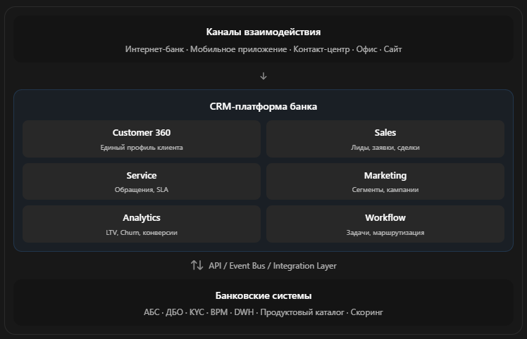
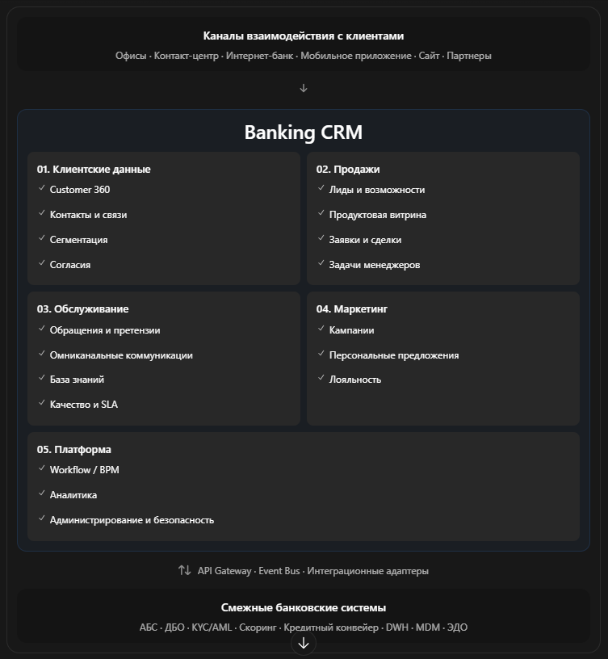

# Customer Relationship Management (CRM)

- [Customer Relationship Management (CRM)](#customer-relationship-management-crm)
  - [Зачем](#зачем)
  - [CRM в банковской сфере](#crm-в-банковской-сфере)
  - [Доменная модель](#доменная-модель)

## Зачем

Класс систем [CRM](http://daemon110282.github.io/arch/system.class/crm.html) (Customer Relationship Management) — система __управления взаимоотношениями с клиентами__, предназначенная для __автоматизации продаж, маркетинга, обслуживания клиентов__ и анализа клиентских данных.

## CRM в банковской сфере

Для банка CRM обычно представляет собой комплексную платформу, объединяющую операционные, аналитические и коммуникационные возможности.

В такой архитектуре CRM не обязательно является мастер-системой всех клиентских данных. Например, счета и остатки могут храниться в АБС, а CRM получает их через API или интеграционные события.
Для проектирования CRM стоит рассматривать три основных функциональных контура: Sales, Service и Marketing.
Customer 360, Analytics, Workflow и Integration Layer целесообразно выделить как общие платформенные возможности.

[Модули и функции](crm.bank.func.md)

## Доменная модель

| Сущность    | Назначение                                            |
| ----------- | ----------------------------------------------------- |
| Customer    | Клиент (ФЛ или ЮЛ)                                    |
| Contact     | Контактное лицо                                       |
| Lead        | Потенциальный клиент или интерес                      |
| Opportunity | Потенциальная сделка                                  |
| Product     | Продукт или услуга                                    |
| Application | Заявка на продукт                                     |
| Interaction | История взаимодействий                                |
| Activity    | Задача, звонок, встреча                               |
| Case        | Обращение клиента                                     |
| Campaign    | Маркетинговая кампания                                |
| Consent     | Согласие клиента на обработку данных или коммуникации |
