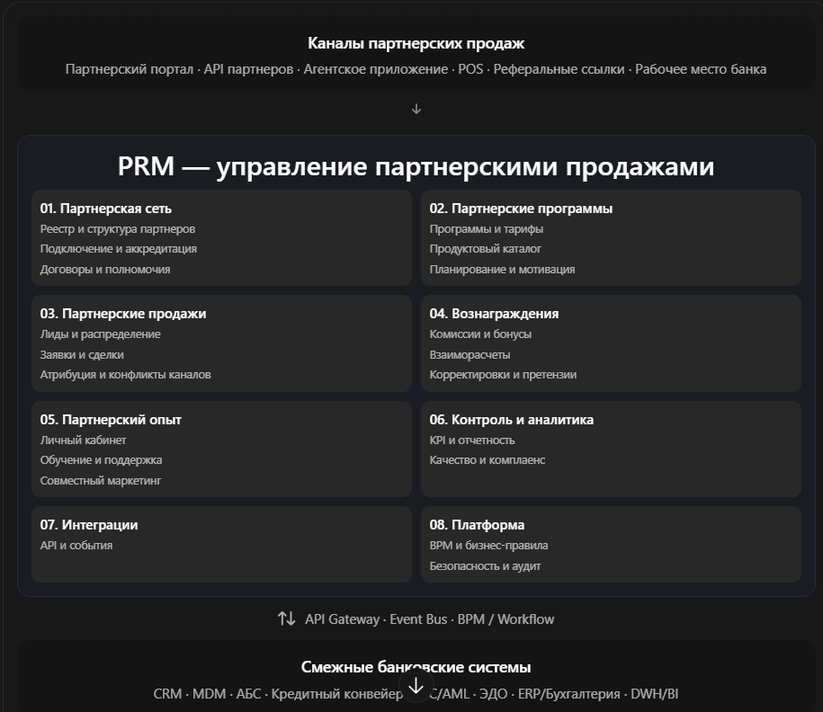

# Partner Relationship Management (PRM) Работа с партнерами

- [Partner Relationship Management (PRM) Работа с партнерами](#partner-relationship-management-prm-работа-с-партнерами)
  - [Зачем](#зачем)
  - [Функции](#функции)
  - [TODO](#todo)
  - [Use case](#use-case)
    - [Сравнение архитектурных моделей](#сравнение-архитектурных-моделей)
  - [Границы ответственности PRM и смежных систем](#границы-ответственности-prm-и-смежных-систем)
  - [Ключевые показатели эффективности](#ключевые-показатели-эффективности)
  - [Доменная модель](#доменная-модель)
    - [Модель идентификаторов](#модель-идентификаторов)

## Зачем

Класс систем [PRM](http://daemon110282.github.io/arch/system.class/prm.html) - функциональный домен [CRM](./crm.md), предназначенный для управления партнерской сетью банка, привлечением клиентов через партнеров, совместными продажами, партнерскими программами и вознаграждениями.

## Функции

[Модули-Функции](https://docs.google.com/spreadsheets/d/1MtpxDRI4N_exJC_ruzgwtBolqQdlrbPGwBrYxE9QVjM/edit?usp=sharing)

## TODO

- [ ] CPC CPA

## Use case

Основные сценарии партнерских продаж в банке

| Модель                                                      | Пример                                                              | Особенности                                         |
| :---------------------------------------------------------- | :------------------------------------------------------------------ | :-------------------------------------------------- |
| Реферальные продажи                                         | Партнер передает банку потенциального клиента на РКО                | Регистрация лида, атрибуция, вознаграждение         |
| Агентские продажи                                           | Агент привлекает клиентов на кредитные продукты                     | Регистрация заявок, контроль статусов, комиссия     |
| Дилерские продажи                                           | Автодилер оформляет автокредит                                      | Партнерская заявка, субсидии, специальные программы |
| Ипотечные партнеры                                          | Застройщик или агентство недвижимости направляет ипотечных клиентов | Партнерские условия, заявки, контроль сделок        |
| Корпоративное партнерство                                   | Бухгалтерская компания привлекает клиентов МСБ                      | Партнерские предложения, планы продаж, мотивация    |
| Marketplace / [Embedded Finance](../cc/embedded.finance.md) | Финтех-сервис предлагает банковский продукт через API               | API-продажи, цифровая атрибуция, Revenue Share      |
| [POS-кредитование](../cc/pos.md)                            | Магазин оформляет заявку покупателя на кредит                       | Интеграция с POS, скоринг, решение, выдача          |

Ключевая особенность __POS-кредитования и Embedded Finance__ заключается в том, что процесс __оформления банковского продукта__ инициируется непосредственно во __внешнем канале партнера__, а не __сотрудником банка в CRM__.

### Сравнение архитектурных моделей

| Критерий                | Классические партнерские продажи  | POS / Embedded Finance                             |
| :---------------------- | :-------------------------------- | :------------------------------------------------- |
| Что передает партнер    | Лид                               | Заявку или запрос на оформление                    |
| Готовность клиента      | Потенциальный интерес             | Намерение получить конкретный продукт              |
| Основной процесс        | Lead-to-Application               | Application-to-Decision                            |
| Нужна квалификация лида | Как правило, да                   | Может отсутствовать                                |
| Требуется быстрый ответ | Не всегда                         | Часто, особенно на POS                             |
| Основная система        | CRM                               | Origination / продуктовый конвейер                 |
| Роль PRM                | Регистрация источника и атрибуция | Управление партнером, условиями и атрибуцией       |
| Роль CRM                | Управление лидами и заявками      | Синхронизация данных, обслуживание или оркестрация |
| Прямой API партнера     | Опционально                       | Обычно необходим для глубокой интеграции           |

__POS-кредитование и Embedded Finance__ не являются основанием переносить функцию создания заявок в PRM.
Они являются основанием предусмотреть __альтернативный способ инициирования продуктовых заявок__ через внешний API, не привязанный к пользовательскому процессу [CRM](crm.md).

## Границы ответственности PRM и смежных систем

В банковской архитектуре важно не дублировать клиентские данные, продуктовые процессы и финансовый учет.

| Данные / процесс                                                                 | Мастер-система                         |
| :------------------------------------------------------------------------------- | :------------------------------------- |
| Прием партнерских заявок, техническая валидация, маршрутизация, статусы, события | Partner Origination Platform           |
| Карточка и структура партнера, управляет партнерами и источниками привлечения    | PRM либо корпоративный MDM             |
| Договоры с партнерами                                                            | СЭД / CLM; PRM хранит ссылки и условия |
| Партнерские программы                                                            | PRM                                    |
| Лиды и атрибуция, управляет клиентскими продажами                                | CRM / PRM                              |
| Клиентские мастер-данные                                                         | MDM / АБС                              |
| Бизнес-проверки, кредитное решение, жизненный цикл продуктовой заявки            | Product Origination / LOS              |
| Кредитные и продуктовые заявки                                                   | Продуктовый конвейер                   |
| Открытие счетов, выдача кредитов                                                 | АБС / продуктовая система              |
| Правила комиссий и начисления, партнерские вознаграждения                        | PRM / Commission Engine                |
| Бухгалтерский учет и выплаты                                                     | ERP / АБС                              |
| Финансовая и управленческая аналитика                                            | DWH / BI                               |
| Аутентификация пользователей                                                     | IAM / SSO                              |
| Документы и электронные подписи                                                  | ЭДО / СЭД                              |

Особенно важно выделить __Commission Engine__ как самостоятельный логический компонент, даже если физически он реализован внутри CRM. Его расчеты должны быть воспроизводимыми, учитывать версии правил, исходные события, корректировки и повторную обработку сообщений.

## Ключевые показатели эффективности

| KPI                            | Метод расчета                                                       |
| :----------------------------- | :------------------------------------------------------------------ |
| Активные партнеры              | Количество партнеров с квалифицирующей активностью за период        |
| Конверсия лидов                | Продажи / квалифицированные лиды × 100%                             |
| Конверсия заявок               | Выданные продукты / поданные заявки × 100%                          |
| Среднее время обработки        | Среднее время от регистрации до целевого статуса                    |
| Стоимость привлечения (CPA)    | Расходы канала / количество привлеченных клиентов                   |
| Доходность партнерского канала | Доходы минус относимые затраты                                      |
| Выполнение плана               | Фактические продажи / план × 100%                                   |
| Доля проблемных продаж         | Отмененные, спорные или некачественные продажи / все продажи × 100% |

## Доменная модель

| Владелец | Сущность       | Назначение                  |
| -------- | -------------- | --------------------------- |
| PRM      | PartnerLead    | Партнерское обращение в PRM |
| PRM      | Partner        |                             |
| PRM      | PartnerProgram |                             |
| PRM      | Attribution    |                             |

### Модель идентификаторов

Чтобы не дублировать бизнес-сущности, важно разграничить идентификаторы.

| Идентификатор         | Владелец                           | Назначение                                 |
| :-------------------- | :--------------------------------- | :----------------------------------------- |
| partnerId             | PRM                                | Партнер, инициировавший заявку             |
| partnerProgramId      | PRM                                | Партнерская программа                      |
| externalApplicationId | Партнер                            | Идентификатор запроса на стороне партнера  |
| requestId             | Partner Origination                | Идентификатор зарегистрированного запроса  |
| applicationId         | LOS                                | Основная продуктовая заявка                |
| customerId            | MDM / банковский клиентский контур | Идентификатор клиента                      |
| contractId            | АБС / продуктовая система          | Договор по оформленному продукту           |
| attributionId         | PRM                                | Результат привязки продажи к партнеру      |
| partnerLeadId         | PRM                                | идентификатор партнерского обращения в PRM |
| crmLeadId             | CRM                                | идентификатор лида в CRM                   |
|                       |                                    |                                            |

requestId и applicationId могут появляться в разное время. Например, Partner Origination приняла запрос, но LOS еще не завершила создание заявки.

Это важно, поскольку несколько партнеров могут передать сведения об __одном потенциальном клиенте__. CRM может __объединить обращения__ в один клиентский лид, но PRM должна сохранить __историю источников привлечения__ и определить, какой __партнер имеет право на вознаграждение__.

Таким образом, CRM выступает __владельцем клиентского лида__, а PRM — __владельцем данных о партнерском происхождении обращения__ и правилах атрибуции.
